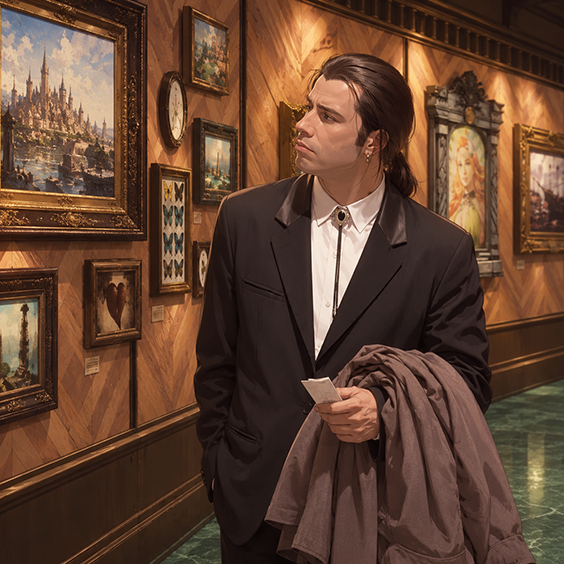

# Frames XIV

Frames XIV catalogues the frames you can buy in Final Fantasy XIV — paintings for now, with portraits, posters and fish prints to come — with vendors, regions, expansions and how to unlock each one.

🔗 [Visit the site](http://luneriane.github.io/frames-xiv)

> This is an unofficial fan project. All game data, names and assets belong to Square Enix.

## Features

- Browsable gallery filterable by region and expansion
- Detail view for each painting with its unlock condition (achievement or vendor access) and direct links to Lodestone, GarlandDB and Teamcraft
- Available in English, French, German and Japanese, with your language choice remembered between visits
- A "what's new" page tracking site updates

## Tech

Plain HTML, CSS and JavaScript — no framework, no build step. Game data is extracted separately (via XIVAPI v2) and shipped as static JSON files.

## Credits

Font Awesome, Square Enix.

---

Found a translation mistake or a broken link? [Open an issue](https://github.com/Luneriane/frames-xiv/issues).